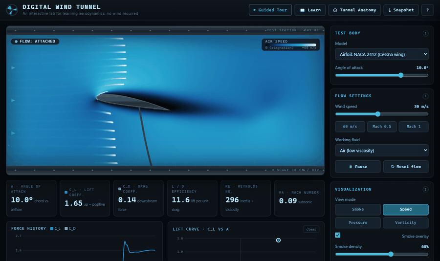

# Digital Wind Tunnel

An interactive, browser-based wind tunnel for learning aerodynamics. A real
fluid simulation runs live in the page, with tooltips, plain-language concept
explanations, and a guided tour of classic experiments.

**[Run it in your browser](https://0rb1.github.io/wind-tunnel/)**, or open `index.html` locally. No build step, no dependencies.

## What it does

- **Real fluid physics.** A D2Q9 lattice-Boltzmann solver (BGK collision with
  Smagorinsky turbulence stabilization) computes the flow every frame. Vortices,
  wakes, stall, and lift emerge from the simulation, not from canned animation.
- **Test bodies:** NACA 4-digit airfoils (with a custom code input), a cylinder,
  a flat plate, or an empty tunnel.
- **Controls:** angle of attack, wind speed (including Mach 0.5 and Mach 1
  presets), working fluid (air / water / syrup), and simulation quality.
- **Visualization:** smoke trails, air speed, pressure coefficient, and
  vorticity, with a color legend and a photographic test-section look.
- **Live instruments:** lift and drag coefficients, L/D, Reynolds number, Mach
  number, a force-history chart, and a lift curve you draw yourself by sweeping
  the angle of attack.
- **Learning layer:** a tooltip on every control, a "Learn" glossary with
  one-click demos, an animated wind-tunnel anatomy diagram, and a step-by-step
  guided tour.

## The physics

The tunnel is a D2Q9 lattice-Boltzmann solver. Each cell holds nine particle
distributions $f_i$ that stream to their neighbors and then relax toward a local
equilibrium (BGK collision):

$$
f_i(\mathbf{x} + \mathbf{e}_i,\ t + 1) = f_i(\mathbf{x}, t) - \frac{1}{\tau}\Big(f_i(\mathbf{x}, t) - f_i^{\mathrm{eq}}(\mathbf{x}, t)\Big)
$$

$$
f_i^{\mathrm{eq}} = w_i\,\rho\left(1 + 3\,\mathbf{e}_i\cdot\mathbf{u} + \tfrac{9}{2}(\mathbf{e}_i\cdot\mathbf{u})^2 - \tfrac{3}{2}\,|\mathbf{u}|^2\right),
\qquad w_0 = \tfrac{4}{9},\ w_{1..4} = \tfrac{1}{9},\ w_{5..8} = \tfrac{1}{36}
$$

Density and velocity are moments of the distributions, $\rho = \sum_i f_i$ and
$\rho\,\mathbf{u} = \sum_i f_i\,\mathbf{e}_i$. The relaxation time sets the
kinematic viscosity of the working fluid (air, water or syrup):

$$
\tau_0 = 3\nu + \tfrac{1}{2}
$$

At high speed a plain BGK grid this coarse goes unstable, so a Smagorinsky
large-eddy model adds eddy viscosity where the non-equilibrium momentum flux
$\Pi^{\mathrm{neq}}$ is large. It can only raise $\tau$, so it only ever
stabilizes:

$$
\tau^{*} = \tfrac{1}{2}\left(\tau_0 + \sqrt{\tau_0^{2} + 18\sqrt{2}\,C_s^{2}\,\frac{|\Pi^{\mathrm{neq}}|}{\rho}}\right),
\qquad C_s \approx 0.14
$$

**Lift** comes straight from the flow, by momentum exchange on the body's
boundary cells, and tracks thin-airfoil theory, $C_L \approx 2\pi\alpha$.
**Drag** on a streamlined body is smaller than this grid can resolve, so it comes
from a drag polar driven by the simulated lift and the measured separation:

$$
C_D = C_{D,0} + k\,C_L^{2} + k_s\,(\text{stall level})
$$

## How the numbers are made (honest note)

Lift is measured directly from the flow (momentum exchange on the body surface)
and tracks thin-airfoil theory (C_L is about 2*pi*alpha). A streamlined shape's
profile drag is smaller than a real-time browser grid can resolve, so drag is
reported from a standard drag polar (base profile drag, a rise with lift
squared, and a separation penalty) driven by the simulated lift and the measured
flow separation. It is a 2-D, low-Reynolds-number, incompressible model, so the
trends are physically faithful but the exact numbers are a smoke-tunnel guide,
not flight-test data.

## Keyboard shortcuts

`Space` pause/resume, `R` reset flow, arrow keys change angle of attack, `V`
cycle view modes, `S` toggle smoke, `?` show help.

## Tech

Single self-contained HTML file: inline CSS and vanilla JavaScript, Canvas 2D
rendering. Nothing to install.
